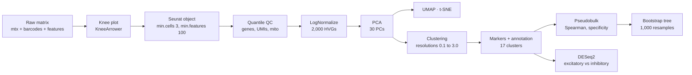

<picture>
  <source media="(prefers-color-scheme: dark)" srcset="assets/visual-abstract-dark.svg">
  
</picture>

<h1 align="center">Single-Cell RNA-seq Analysis of the Pleurodeles Brain</h1>

<p align="center">
  A complete Seurat v5 pipeline for salamander scRNA-seq, from raw droplets to annotated neurons and glia, cluster stability and pseudobulk differential expression
</p>

<p align="center">
  
  
  
  
  
</p>

<p align="center">
  <a href="#overview">Overview</a> &nbsp;·&nbsp; <a href="#analysis-workflow">Workflow</a> &nbsp;·&nbsp; <a href="#cell-type-annotation">Cell types</a> &nbsp;·&nbsp; <a href="#statistical-validation">Validation</a> &nbsp;·&nbsp; <a href="#how-to-run">How to run</a>
</p>

---

## At a glance

| **17** | **2,000** | **30** | **6** | **1,000** |
|:---:|:---:|:---:|:---:|:---:|
| annotated clusters | highly variable genes | principal components | clustering resolutions tested | bootstrap resamples |

> **Take-home:** knee-plot QC and Seurat clustering resolve 17 clusters, ranging from GABAergic and excitatory neurons to astrocytes, microglia and oligodendrocytes. Furthermore, 1,000 bootstrap resamples and pseudobulk DESeq2 test how robust and how distinct these populations are.

## Skills demonstrated

| Area | Evidence in this repository |
|---|---|
| **Single-cell QC** | Knee-plot droplet calling with KneeArrower, species-specific mitochondrial genes and quantile-based outlier filtering |
| **Dimensionality reduction** | LogNormalize, 2,000 highly variable genes, PCA with elbow selection, UMAP, t-SNE and hexbin density plots |
| **Clustering and annotation** | Graph-based clustering at six resolutions, FindAllMarkers and knowledge-guided annotation of 17 clusters |
| **Statistical validation** | Spearman correlation on pseudobulk profiles, a specificity index and hierarchical clustering with 1,000 bootstrap resamples |
| **Differential expression** | Pseudobulk DESeq2 comparing excitatory and inhibitory neurons |
| **R programming** | Seurat v5, DESeq2, dplyr, ggplot2, pheatmap and ggdendro in a reproducible R Markdown report |

## Overview

This repository contains a complete computational pipeline for single-cell RNA sequencing (scRNA-seq) data from the salamander *Pleurodeles*. The workflow runs from raw-droplet quality control to the identification of distinct neuronal and glial populations, and it then tests how stable and how transcriptionally distinct those populations are.

**Key features**

- **Quality control:** a knee-plot algorithm separates valid cells from ambient-RNA droplets.
- **Dimensionality reduction:** PCA, UMAP and t-SNE capture both global and local transcriptomic structure.
- **Cell annotation:** 17 clusters, including GABAergic neurons, astrocytes and microglia, are annotated with a hybrid of prior biological knowledge and unbiased marker discovery.
- **Statistical validation:** hierarchical clustering with 1,000 bootstrap resamples evaluates cluster stability, and pseudobulk DESeq2 compares excitatory and inhibitory neurons.

## Analysis workflow



### 1. Data preprocessing and filtering

- **Knee plot:** identifies the inflection point of UMI counts per barcode to exclude empty and low-quality droplets.
- **Seurat object:** genes detected in at least 3 cells and cells with at least 100 detected genes are kept.
- **Mitochondrial QC:** mitochondrial percentage uses the *Pleurodeles* mitochondrial genes (ND1 to ND6, COX1 to COX3, CYTB and ATP6), since a small subset of raw cells reaches up to 60% mitochondrial reads.
- **Outlier removal:** cells below the 1st percentile of detected genes, above the 99th percentile of UMIs or above the 95th percentile of mitochondrial reads are removed.

### 2. Variable feature selection

The top 2,000 highly variable genes focus the analysis on biological signal rather than technical noise. Prominent variable genes include:

- **Neurotransmission and signaling:** *PTGDS*, *TAC1*, *CCK*, *NPY*, *NTS*, *SST*, *SCGN*
- **Structural and immune:** *CST3*, *C1QB*, *PDGFRA*

### 3. Dimensionality reduction and clustering

PCA is followed by an elbow plot to choose 30 principal components, which then feed UMAP, t-SNE and a shared nearest-neighbor graph (k = 20). Clustering is run at resolutions 0.1, 0.3, 0.5, 1, 2 and 3, and resolution 0.3 is used for annotation.

## Cell-type annotation

Clusters at resolution 0.3 were annotated from their top marker genes, combining known biology with unbiased `FindAllMarkers` results.

| Cluster | Annotated cell type | Top marker |
|:---:|---|---|
| 0 | GABAergic neurons | *SHISA8* |
| 1 | Interneurons | *GABRA3* |
| 2 | Astrocytes | *GJA1* |
| 3 | Excitatory neurons | *TBR1* |
| 4 | Glial cells | *HPCAL1* |
| 5 | Excitatory neurons | *LHX9* |
| 6 | Inhibitory neurons | *SV2C* |
| 7 | Vascular cells | *CDH2* |
| 8 | Excitatory neurons | *KCNK3* |
| 9 | Peptidergic neurons | *PDYN* |
| 10 | Oligodendrocyte precursors | *SLC38A4* |
| 11 | Microglia | *CSF1R* |
| 12 | Neural progenitors | *LHX6* |
| 13 | Non-telencephalic neurons | *CRISPLD2* |
| 14 | Oligodendrocytes | *NKX2-2* |
| 15 | Olfactory ensheathing cells | *FOXD3* |
| 16 | Immune cells | *TBX21* |

## Statistical validation

- **Transcriptomic relationships:** a Spearman correlation on pseudobulk-aggregated profiles measures similarity between cell types.
- **Specificity index:** quantifies how uniquely each gene is expressed within a lineage.
- **Cluster stability:** hierarchical clustering on the specificity matrix with 1,000 bootstrap resamples, displayed as an ultrametric tree with support values.
- **Differential expression:** pseudobulk DESeq2 between excitatory and inhibitory neurons, summarized as a heatmap of the top 20 genes.

## How to run

```r
install.packages(c("Seurat", "dplyr", "ggplot2", "patchwork", "pheatmap", "ggdendro"))
BiocManager::install("DESeq2")
# KneeArrower (knee-point detection) is installed from its GitHub repository

# Set the data folder in the first chunk, then knit the report
rmarkdown::render("Brandon_chua_Report.Rmd")
```

The report expects the 10x-style `matrix.mtx`, `barcodes.tsv` and `features.tsv` files. Knitting it also writes `top_markers_per_cluster.csv` (cluster markers) and `annotated_seurat_obj.rds` (the final annotated Seurat object).

## Tech stack

- **Language:** R
- **Framework:** [Seurat v5](https://satijalab.org/seurat/)
- **Differential expression:** [DESeq2](https://bioconductor.org/packages/release/bioc/html/DESeq2.html)
- **Visualization:** ggplot2, pheatmap, ggdendro, hexbin plots

## Repository structure

```
├── Brandon_chua_Report.Rmd   # Full analysis and written report
├── assets/                   # Visual abstract (light and dark)
└── LICENSE
```

**Author:** Brandon Chua · **Date:** April 2025 · **Project:** Single-cell sequencing report

## License

Released under the [MIT License](LICENSE).
